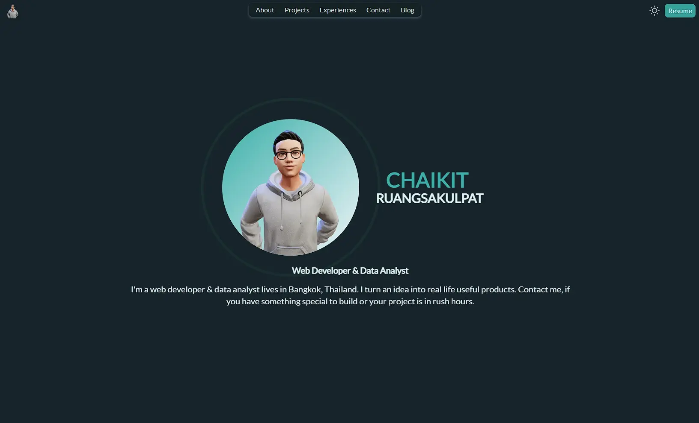

# [My Portfolio](https://www.chaikitr.com/)

This is a first project of my web developer journey. It taught me a lot when I have to do real work. This project shows who am I, what project I complete, what skill I have, where I work before, my contact, and link to my blog. I use Next, Tailwind, Framer, and Sanity to build the project.



## Features

- Monochrome dark design with a light theme toggle
- Responsive layout with scroll-reveal animation
- Project carousel, experience timeline, skill stack
- Content managed in Sanity (headless CMS), revalidated hourly

## Tools

- Next.js 16 (App Router, TypeScript)
- Tailwind CSS 4
- Motion
- Sanity (studio in `backend-sanity/`)

## Development

```bash
npm install
npm run dev     # http://localhost:3000
npm run build
npm run lint    # Biome lint + format check
npm run format  # apply Biome fixes and formatting
```

Content comes from the public Sanity dataset `r5zw8ps4/production` by default. Override with `NEXT_PUBLIC_SANITY_PROJECT_ID` and `NEXT_PUBLIC_SANITY_DATASET` (see `.env.example`).
